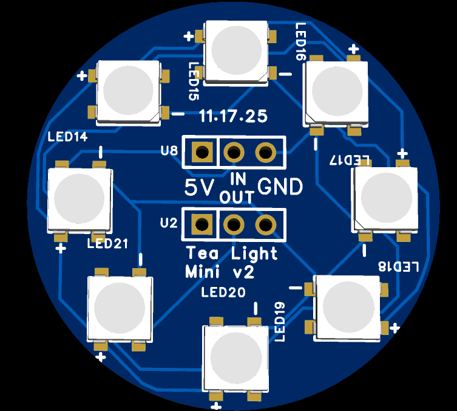
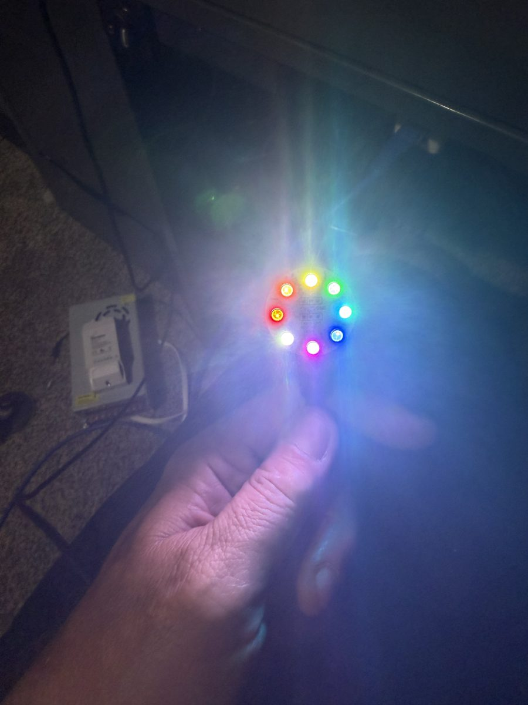
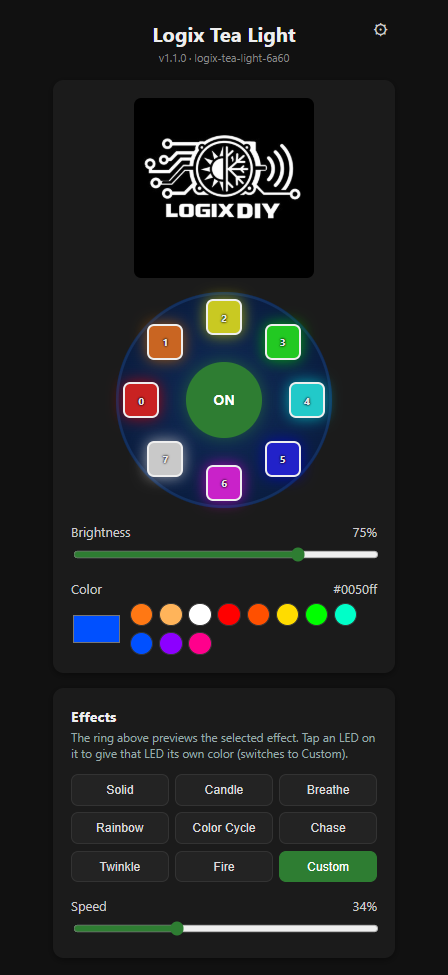
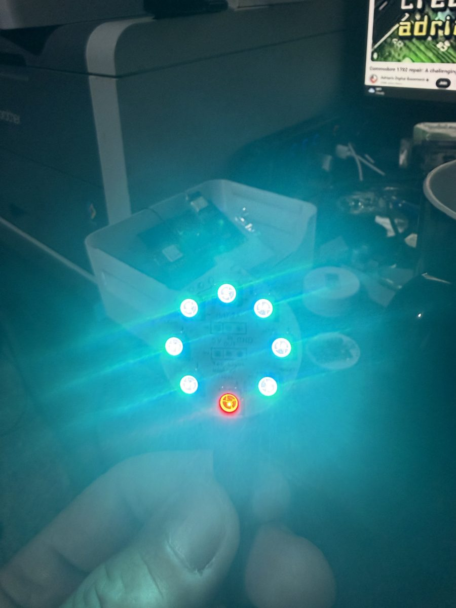
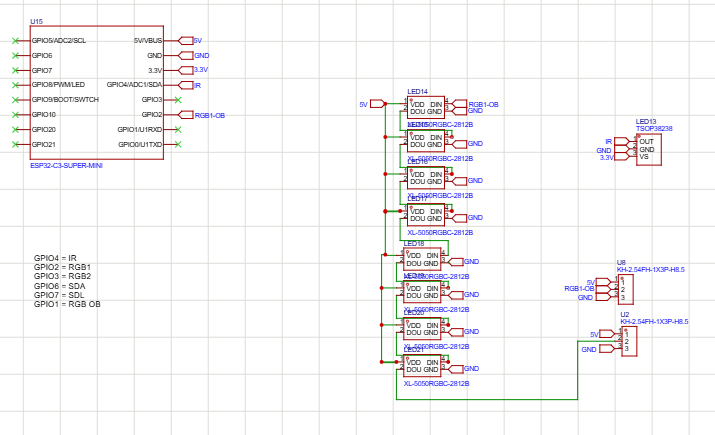

# Logix Tea Light Mini v2

Firmware for the **Tea Light Mini v2**, a round board with 8 addressable RGB LEDs
(XL-5050RGBC-2812B, WS2812-compatible) driven by an **ESP32-C3 Super Mini**, plus an optional
TSOP38238 IR receiver. It joins your WiFi and serves a WebUI with a live preview of the selected
effect. It also has a simple HTTP API and optional IR remote control.

<p align="center">
  
  
</p>

## Features

- **9 effects:** Solid, Candle, Breathe, Rainbow, Color Cycle, Chase, Twinkle, Fire and Custom
  (one color per LED).
- **WebUI** with an animated ring that previews the current effect, color, brightness and speed.
  Tap an LED on the ring to give it its own color.
- **Saves everything:** power, color, brightness, effect, speed, per-LED colors and settings are
  kept across reboots. Power on/off fades smoothly.
- **WiFi setup from your phone** through a setup hotspot (WiFiManager). Once set up, the board is
  at `http://<device-name>.local`.
- **HTTP API** for Home Assistant or scripts. See [API](#api) and [`openapi.yaml`](openapi.yaml).
- **IR remote** (NEC protocol, learnable buttons) on boards with the IR chip fitted. It's off by
  default.
- **Daisy-chaining:** up to 64 LEDs across several boards.
- **Over-the-air updates** with ArduinoOTA.

## WebUI

<p align="center">
  
  
</p>

The ring at the top matches the LED layout on the board. Each square is labelled with its
position in the LED chain (0–7), and the power button sits in the middle. Below it are
brightness, color, preset color swatches, the effect buttons and a speed slider.

The gear icon opens **Device Settings**:

| Setting | What it does |
| --- | --- |
| Device name | Changes the `.local` name the board answers to (the board reboots) |
| LED count | 8 per board; raise it when boards are daisy-chained (max 64) |
| LED ring rotation | Turns the on-screen ring one LED at a time until it lines up with your board. Only the screen changes. |
| IR remote receiver | Shows the IR Remote section and enables the receiver. Leave it off if the IR chip isn't fitted. |
| Configure WiFi | Opens the WiFi Manager on port 8080 without dropping the current connection |
| Restart | Reboots the board |

## Hardware

<p align="center">
  
</p>

| Function | Pin |
| --- | --- |
| WS2812 data (net `RGB1-OB`, also on the U8 "IN" header) | GPIO2 |
| IR receiver (TSOP38238, optional, active-low output) | GPIO4 |

- **LED order:** the first LED in the chain (LED 0) is at the **9 o'clock** position, and the
  chain runs clockwise.
- **Daisy-chaining:** the last LED's data output is on the U2 "OUT" header (5V / OUT / GND). Wire
  it to the next board's U8 "IN" header and raise **LED count** in Device Settings.
- **Power:** 8 LEDs at full white draw about 480 mA. Size the 5 V supply for the number of boards
  in the chain.

### About the ESP32-C3 Super Mini's WiFi

The C3 Super Mini is cheap, but its built-in antenna varies a lot from batch to batch. While
developing this firmware, one module could barely see nearby networks, and its setup hotspot was
invisible even with a 31 mm wire antenna soldered on. Replacing the module fixed it straight away.
The firmware sets the transmit power to 17 dBm, which was the most reliable level in testing.

If the setup hotspot doesn't appear:

1. Check the serial log (115200 baud over USB). If it shows
   `Setup hotspot "Logix Tea Light Setup" active`, the firmware is fine and the module's radio is
   the likely problem.
2. Try a different C3 Super Mini before changing anything else.

## Build and flash

Requires [PlatformIO](https://platformio.org/).

1. Copy `include/secrets.h.example` to `include/secrets.h`, then set:
   - `AP_PASSWORD`: the setup hotspot password, at least 8 characters.
   - `OTA_PASSWORD`: protects over-the-air updates.

   `secrets.h` is gitignored.
2. Connect the C3 Super Mini over USB and run:

   ```sh
   pio run -t upload
   ```

   Add `--upload-port COMx` if you have more than one serial device connected.
3. Later updates can go over WiFi with ArduinoOTA. See the comment at the end of
   [`platformio.ini`](platformio.ini).

## First-time setup

1. Power the board. With no saved WiFi details, it starts a hotspot called
   **Logix Tea Light Setup** (password: your `AP_PASSWORD`). The LEDs keep running in the
   meantime.
2. Join the hotspot from your phone. The setup page should open by itself; if not, go to
   `192.168.4.1`.
3. Pick your WiFi network, enter its password and save.
4. Open `http://logix-tea-light-XXXX.local`, where `XXXX` is the last 4 hex digits of the
   board's MAC address. The serial log also prints the address once the board connects.

If the saved network is down at boot, the hotspot comes back. Every 5 minutes the board reboots to
retry the saved network.

## Effects

| Effect | Uses selected color | Description |
| --- | --- | --- |
| Solid | ✓ | Steady color |
| Candle | ✓ | Each LED flickers on its own and shifts toward red when it dims |
| Breathe | ✓ | Slow fade in and out |
| Rainbow | | Rainbow spread around the ring and rotating |
| Color Cycle | | All LEDs fade through the color wheel together |
| Chase | ✓ | A bright head with a fading tail circles the ring |
| Twinkle | ✓ | Random LEDs sparkle over a dim base |
| Fire | | Fast, warm, flame-like flicker |
| Custom | | A separate color for each LED |

The speed slider affects every animated effect.

## IR remote (optional)

Most boards are built without the TSOP38238, so IR is **off by default**. If yours has the IR chip,
turn on **IR remote receiver** in Device Settings and the IR Remote section appears.

The receiver decodes the NEC protocol, which most cheap LED remotes use. To assign a button:

1. Press **Learn** next to an action.
2. Press the remote button within 15 seconds.

These actions can be learned:

- Power toggle
- Brightness + / −
- Next / previous effect
- Next color preset
- Speed + / −

Holding a brightness or speed button keeps adjusting.

## API

All endpoints use plain `GET` on port 80. Control endpoints return the full status JSON.

| Endpoint | Description |
| --- | --- |
| `GET /` | WebUI |
| `GET /status` | Current state (see below) |
| `GET /effects` | List of effects: `[{"id":"candle","name":"Candle"}, ...]` |
| `GET /on` \| `/off` \| `/toggle` | Power control |
| `GET /set?power=&color=&brightness=&effect=&speed=&leds=` | Change any subset of settings in one call. `power` = `on`/`off`/`toggle`, `color` = `rrggbb`, `brightness`/`speed` = 1–100, `effect` = effect id, `leds` = 1–64 |
| `GET /pixel/set?index=0&color=ff0000` | Set one LED and switch to Custom |
| `GET /pixels/set?colors=ff0000,00ff00,...` | Set LEDs from index 0 onward and switch to Custom |
| `GET /ir/learn?action=power` | Learn the next IR code for an action |
| `GET /ir/cancel` | Cancel learning |
| `GET /ir/clear?action=power` | Forget the code for an action |
| `GET /config/ir?enabled=on` | Turn the IR receiver on or off |
| `GET /config/ring?step=1` | Rotate the WebUI ring one LED clockwise (`-1` for counter-clockwise, or `value=0..7`) |
| `GET /config/hostname?name=` | Rename the device (it reboots) |
| `GET /wifi-config` | Start the WiFi Manager portal on port 8080 |
| `GET /forget-wifi` | Clear WiFi credentials and reboot into the setup hotspot |
| `GET /restart` | Reboot |

Effect ids: `solid`, `candle`, `breathe`, `rainbow`, `color_cycle`, `chase`, `twinkle`, `fire`,
`custom`.

IR action ids: `power`, `bright_up`, `bright_down`, `effect_next`, `effect_prev`,
`color_next`, `speed_up`, `speed_down`.

Example `/status` response:

```json
{
  "power": true, "color": "#ff7814", "brightness": 60, "effect": "candle", "speed": 50, "leds": 8,
  "pixels": ["#ff7814", "..."],
  "ir": { "last": "", "learning": null, "codes": { "power": "", "...": "" }, "enabled": false },
  "ringRotation": 0,
  "hostname": "logix-tea-light-a1b2", "ip": "192.168.1.50", "rssi": -58, "version": "1.1.0"
}
```

[`openapi.yaml`](openapi.yaml) has the full machine-readable schema.

### Examples

```sh
# Warm candle at 40%
curl "http://logix-tea-light-a1b2.local/set?power=on&effect=candle&color=ff7814&brightness=40"

# Turn off
curl "http://logix-tea-light-a1b2.local/off"

# Give each LED its own color
curl "http://logix-tea-light-a1b2.local/pixels/set?colors=ff0000,ff8000,ffff00,00ff00,00ffff,0000ff,ff00ff,ffffff"
```

### Home Assistant

The plain HTTP API works with Home Assistant's RESTful integrations. For example, use a
`rest_command` that calls `/set?power=on&effect=candle`, and a `rest` sensor that polls `/status`.

## Project layout

```
src/main.cpp            Firmware and the embedded WebUI
include/secrets.h       Your passwords (gitignored; copy from secrets.h.example)
data/logo.jpg           Logo embedded into the firmware for the WebUI
images/                 Schematic, PCB render, photos and WebUI screenshot
openapi.yaml            API schema
platformio.ini          Build configuration (ESP32-C3, Arduino framework)
```
